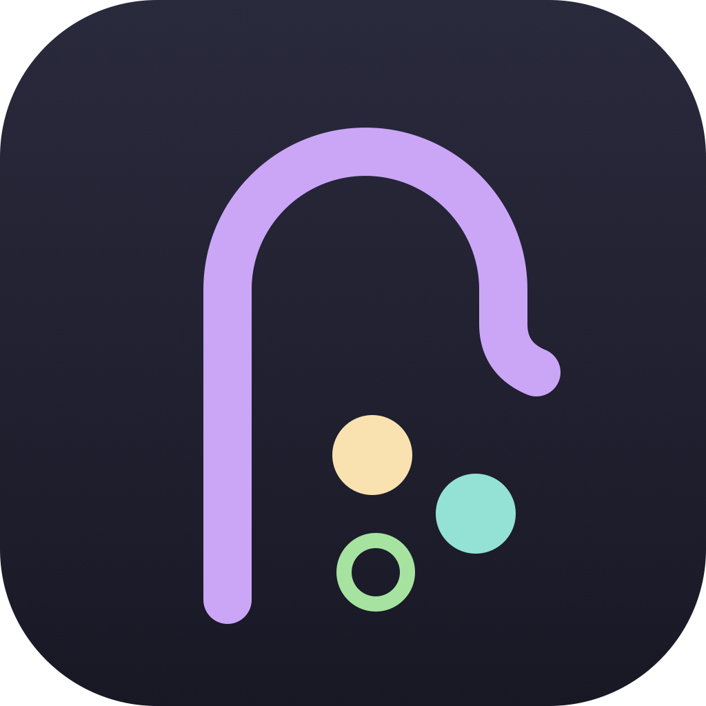
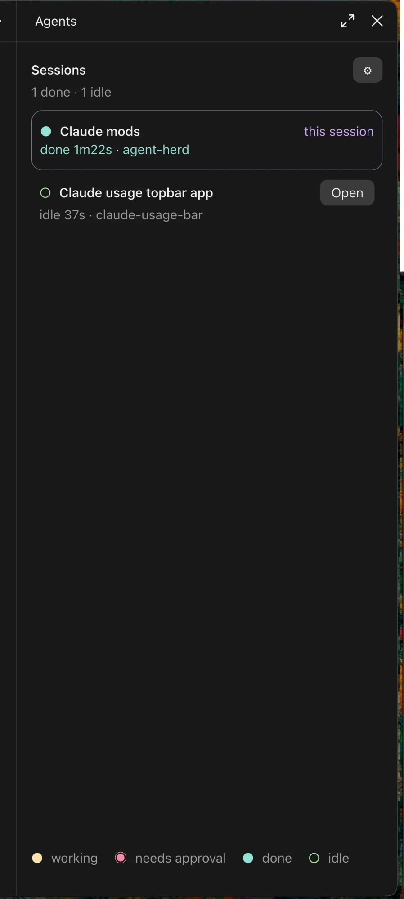

# agent-shepherd

A herdr-style status pane for Claude Code. It sits beside the chat and shows every session and subagent you have running, each with its state, so you can see at a glance which one is working, which one needs you, and which one is done.

> **Made for the Claude desktop app.** The pane, the Open buttons and the session list are built around the desktop app's Code tab. In the terminal CLI the mod does nothing at all: no pane, no sounds, no `/shepherd` command, no heartbeat, so a terminal session won't appear in the desktop panes either. VS Code sessions get the pane too, but it's only tested in the desktop app.



## What it does

- **Every session, live.** Each Claude Code session that runs the mod writes a small heartbeat every few seconds; every pane reads them all. Sessions that don't run the mod yet (already open when you installed it) are picked up from the desktop app's session records and their transcripts.
- **herdr's states and colors.** ● working, ◉ needs approval, ● done, ○ idle, and ✕ failed for subagents. Sessions that need you sort to the top.
- **Open any session.** Each row has an Open button that jumps the desktop app to that session.
- **Subagents.** A collapsible section lists this session's subagents with their task, type, tool count and current tool.
- **Sounds.** A sound when a session finishes and another when it needs approval: two chimes that ship with the mod, any macOS system sound, or your own. Drop `.wav`, `.aiff`, `.mp3` or `.m4a` files in `~/.claude/agent-shepherd/sounds/` (or point settings at another folder) and they join both lists.
- **Settings.** The ⚙ button opens settings, saved for every session: open the pane in every new session, your sounds folder, the two sounds (each with a ▶ preview), hide subagents, start them collapsed, hide idle sessions, hide finished subagents, and how long a quiet session stays listed.

## Install

At the prompt of a terminal session:

```
/plugin install agent-shepherd --marketplace Gillysuit/agent-shepherd
```

Answer `y` to add the marketplace, then pick a scope (user scope loads it in every session).

From a shell:

```bash
claude plugin install agent-shepherd --marketplace Gillysuit/agent-shepherd
```

In the desktop app, where `/plugin` does not run: click **+** next to the prompt box, then **Plugins**, **Add marketplace** with `Gillysuit/agent-shepherd`, then **Add plugin**.

Once installed, the pane opens in each new session (turn that off in ⚙). `/shepherd` opens it any time.

## Notes

- **Approvals need the mod.** A session that doesn't run the mod can show working, done or idle, but not "needs approval": a pending permission prompt isn't written to its transcript. Restart it once and it runs the mod like the rest.
- **The desktop records are undocumented.** The desktop app's session files aren't a public API. If an update changes them, those extra rows disappear; sessions running the mod keep working. The mod only reads them.
- **Sounds play with `afplay`**, so they work on macOS. Elsewhere they stay silent.
- **Open uses the desktop app's links** (`claude://claude.ai/epitaxy/…`), so it only works with the desktop app installed.
- **Files it writes:** one heartbeat file per session in `~/.claude/agent-shepherd/sessions/`. The mod can't delete files, so old ones build up there; they're tiny and ignored once stale, and safe to clear.

## Development

The hooks module is `hooks/register.tsx`; the pane is drawn in `hooks/renderPane.tsx` and `hooks/renderSettings.tsx`. To run it from a checkout, start Claude Code with `claude --plugin-dir <this folder>`, or list the folder in `CLAUDE_CODE_PLUGIN_DIRS`. Checks:

```bash
claude plugin validate .
```

```bash
claude plugin test .
```

## License

MIT
